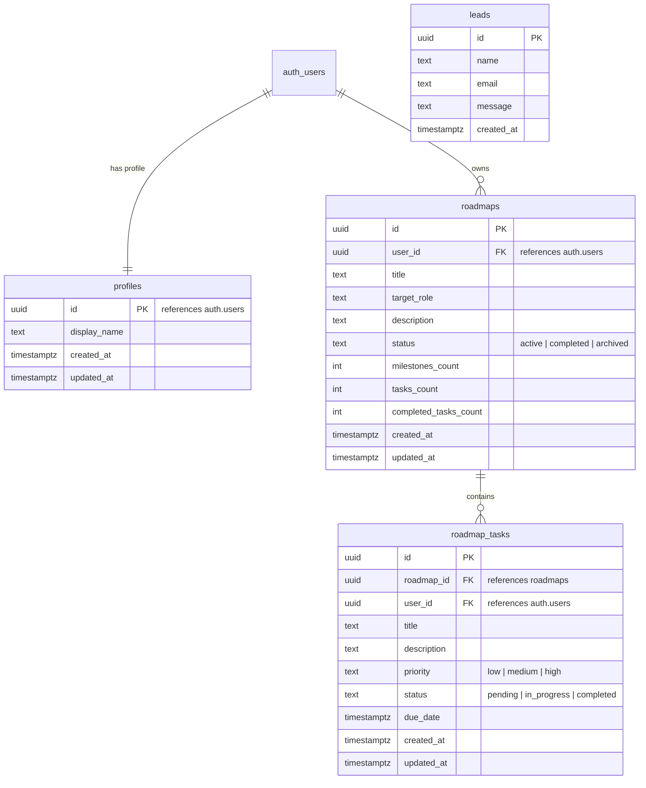
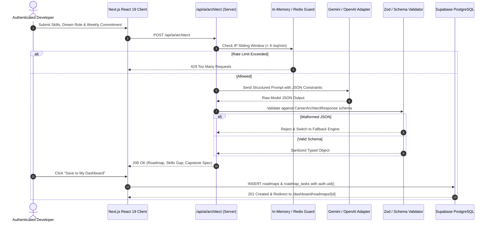

# SkillForge AI — System Architecture & Engineering Specifications

## 1. System Overview

SkillForge AI is an autonomous, full-stack AI-powered micro-SaaS platform designed to help students, fresh graduates, and career transitioners bridge technical competency gaps by converting aspirations into structured, verifiable learning roadmaps, daily task trackers, and production-grade portfolio capstones.

```
+-------------------------------------------------------------------------------+
|                             CLIENT APPLICATION                                |
|  - Next.js 15 App Router (React 19, Turbopack, Tailwind CSS v4)              |
|  - Isomorphic ThemeProvider (Dark / Light with localStorage persistence)     |
|  - Isomorphic AuthProvider (Supabase Auth + 1-Click Demo Session)            |
|  - Interactive Dashboard & Roadmap Task Manager (Optimistic Updates)          |
+-------------------------------------------------------------------------------+
                                      |
                     HTTPS / JSON RPC | Cookie Sessions
                                      v
+-------------------------------------------------------------------------------+
|                       API & ORCHESTRATION LAYER                               |
|  - Next.js Middleware Session Refresh & Route Guards                          |
|  - Rate-Limiting Engine (Token Bucket / IP Sliding Window)                    |
|  - /api/leads: Validation, Sanitization, Duplicate Suppression                |
|  - /api/ai/architect: Career Architect Prompt Engine                          |
|  - Multi-Provider Adapter (Google Gemini 1.5, OpenAI GPT-4o, Deterministic)  |
|  - Zod / Schema Validator & Output Sanitizer                                  |
+-------------------------------------------------------------------------------+
                        |                               |
       PostgreSQL / RLS |                               | Model REST API
                        v                               v
+-------------------------------+               +-------------------------------+
|     SUPABASE DATA LAYER       |               |        AI PROVIDERS           |
|  - auth.users                 |               |  - Google Gemini 1.5 Flash    |
|  - profiles                   |               |  - OpenAI GPT-4o-mini         |
|  - roadmaps                   |               |  - Deterministic Fallback     |
|  - roadmap_tasks              |               |    Engine (Zero-Cost Testing) |
|  - leads                      |               +-------------------------------+
+-------------------------------+
```

---

## 2. Relational Database Schema & Entity Relationships

The database architecture is designed with UUID primary keys, strict foreign key constraints with `ON DELETE CASCADE`, timestamp triggers, and index optimization.



---

## 3. Row-Level Security (RLS) Policy Specifications

To ensure strict tenant isolation, all tables in the `public` schema have Row-Level Security explicitly enabled (`ALTER TABLE ... ENABLE ROW LEVEL SECURITY`).

| Table | Policy Name | Command | Target Role | Using / With Check Clause |
| :--- | :--- | :--- | :--- | :--- |
| `profiles` | Users can view own profile | `SELECT` | `authenticated` | `auth.uid() = id` |
| `profiles` | Users can update own profile | `UPDATE` | `authenticated` | `auth.uid() = id` |
| `roadmaps` | Users can view own roadmaps | `SELECT` | `authenticated` | `auth.uid() = user_id` |
| `roadmaps` | Users can create own roadmaps | `INSERT` | `authenticated` | `auth.uid() = user_id` |
| `roadmaps` | Users can update own roadmaps | `UPDATE` | `authenticated` | `auth.uid() = user_id` |
| `roadmaps` | Users can delete own roadmaps | `DELETE` | `authenticated` | `auth.uid() = user_id` |
| `roadmap_tasks` | Users can view own tasks | `SELECT` | `authenticated` | `auth.uid() = user_id` |
| `roadmap_tasks` | Prevent cross-tenant tasks | `INSERT` | `authenticated` | `auth.uid() = user_id AND EXISTS (SELECT 1 FROM roadmaps r WHERE r.id = roadmap_id AND r.user_id = auth.uid())` |
| `roadmap_tasks` | Prevent cross-tenant updates | `UPDATE` | `authenticated` | `auth.uid() = user_id AND EXISTS (SELECT 1 FROM roadmaps r WHERE r.id = roadmap_id AND r.user_id = auth.uid())` |
| `leads` | Anyone can submit leads | `INSERT` | `anon, authenticated` | `true` |
| `leads` | Only service role can read | `SELECT` | `service_role` | `true` (Prevents lead scraping) |

---

## 4. AI Career Architect Request Flow


