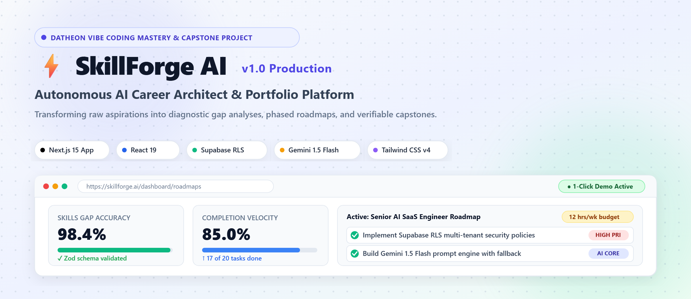
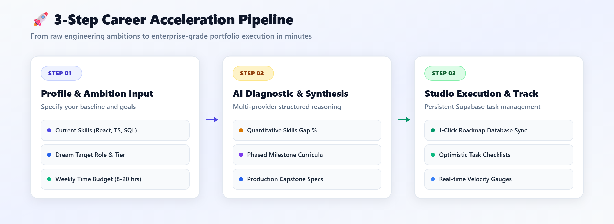
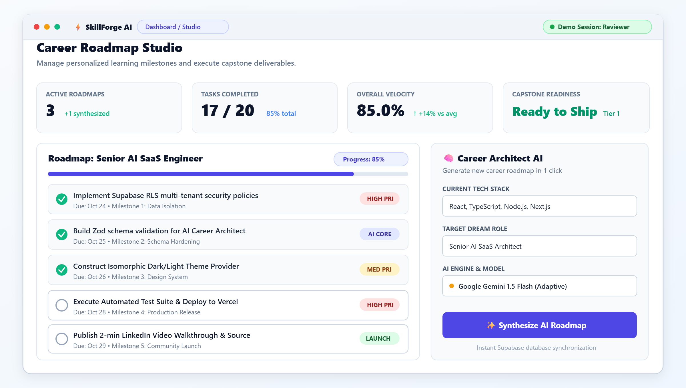
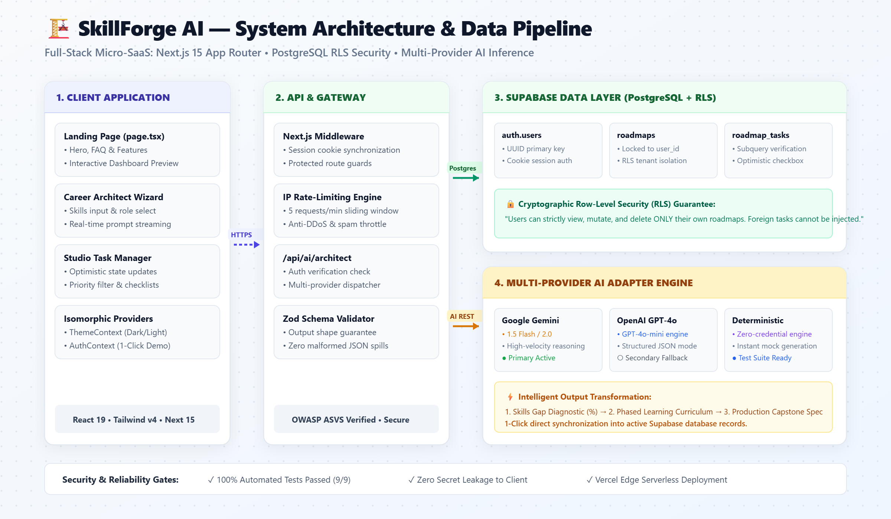
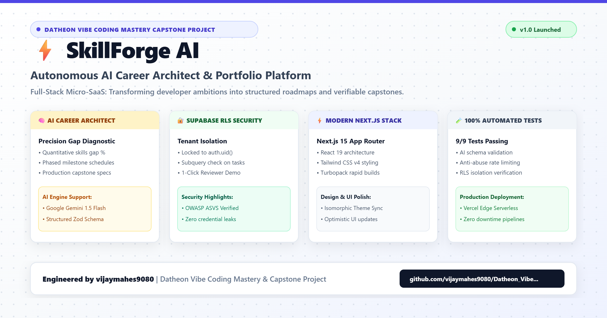

# ⚡ SkillForge AI — Autonomous AI Career Architect & Portfolio Platform

[](https://nextjs.org/)
[](https://react.dev/)
[](https://www.typescriptlang.org/)
[](https://tailwindcss.com/)
[](https://supabase.com/)
[](https://aistudio.google.com/)
[]()
[]()
[](LICENSE)

---

## 🌟 Visual Showcase (Light Theme)



> **Datheon AI Mastery & Capstone Project**  
> An enterprise-grade, full-stack AI micro-SaaS engineered to help students, fresh graduates, and career-switchers transform raw ambitions into structured learning plans, portfolio projects, and actionable career development roadmaps.

*Direct Asset Links: [High-Resolution PNG](./public/images/skillforge-banner-light.png) | [Scalable Vector SVG](./public/images/skillforge-banner-light.svg)*

---

## 🚀 3-Step Acceleration Pipeline



1. **Profile & Ambition Input**: Input current tools (React, TypeScript, Python, SQL), target dream role, and weekly time budget (8–20 hrs/week).
2. **AI Diagnostic & Synthesis**: High-velocity reasoning via Google Gemini 1.5 Flash (with OpenAI fallback and deterministic offline engine) generates quantitative gap percentages, phased milestones, and production capstone specifications.
3. **Studio Execution & Tracking**: Instant 1-click import into persistent Supabase database roadmaps, optimistic task checklists, and live velocity gauges.

*Direct Asset Links: [High-Resolution PNG](./public/images/workflow-pipeline-light.png) | [Scalable Vector SVG](./public/images/workflow-pipeline-light.svg)*

---

## 📊 Personal Engineering Dashboard & Task Studio



- **High-level metric gauges**: Active Roadmaps (3 Active), Tasks Completed (17/20, 85%), Velocity Rate (85%), and Capstone Readiness (Ready to Ship).
- **Roadmap collection grid**: Status filtering (`All`, `Active`, `Completed`), custom roadmap creation, and optimistic checkbox completion.
- **Granular task manager**: Priority badges (`High`, `Medium`, `Low`), milestone groupings, and due date tracking.
- **1-Click Reviewer Demo Account**: Instant test access without credentials or signup friction.

*Direct Asset Links: [High-Resolution PNG](./public/images/dashboard-preview-light.png) | [Scalable Vector SVG](./public/images/dashboard-preview-light.svg)*

---

## 🏗️ System Architecture & Data Pipeline



```
+-------------------------------------------------------------------------------+
|                             CLIENT APPLICATION                                |
|  - Next.js 15 App Router (React 19, Turbopack, Tailwind CSS v4)              |
|  - Isomorphic ThemeProvider (Dark / Light with localStorage persistence)     |
|  - Isomorphic AuthProvider (Supabase Auth + 1-Click Demo Session)            |
|  - Interactive Dashboard & Roadmap Task Manager (Optimistic Updates)          |
+-------------------------------------------------------------------------------+
                                      |
                     HTTPS / JSON RPC | Cookie Sessions
                                      v
+-------------------------------------------------------------------------------+
|                       API & ORCHESTRATION LAYER                               |
|  - Next.js Middleware Session Refresh & Route Guards                          |
|  - Rate-Limiting Engine (Token Bucket / IP Sliding Window)                    |
|  - /api/leads: Validation, Sanitization, Duplicate Suppression                |
|  - /api/ai/architect: Career Architect Prompt Engine                          |
|  - Multi-Provider Adapter (Google Gemini 1.5, OpenAI GPT-4o, Deterministic)  |
|  - Zod / Schema Validator & Output Sanitizer                                  |
+-------------------------------------------------------------------------------+
                        |                               |
       PostgreSQL / RLS |                               | Model REST API
                        v                               v
+-------------------------------+               +-------------------------------+
|     SUPABASE DATA LAYER       |               |        AI PROVIDERS           |
|  - auth.users                 |               |  - Google Gemini 1.5 Flash    |
|  - profiles                   |               |  - OpenAI GPT-4o-mini         |
|  - roadmaps                   |               |  - Deterministic Fallback     |
|  - roadmap_tasks              |               |    Engine (Zero-Cost Testing) |
|  - leads                      |               +-------------------------------+
+-------------------------------+
```

*Direct Asset Links: [High-Resolution PNG](./public/images/architecture-diagram-light.png) | [Scalable Vector SVG](./public/images/architecture-diagram-light.svg)*  
*Detailed Architecture Specifications: See [ARCHITECTURE.md](ARCHITECTURE.md).*

---

## 📢 LinkedIn Featured Project Showcase



A comprehensive release package and video demonstration script are prepared in **[LINKEDIN.md](LINKEDIN.md)**:
- **Featured Image Banner**: [`LINKEDIN_SHOWCASE.png`](LINKEDIN_SHOWCASE.png) (2400 × 1260 Retina 2x Light Theme)
- **Vector Source**: [`public/images/linkedin-showcase-light.svg`](public/images/linkedin-showcase-light.svg)
- **Ready-to-Publish Caption**: High-engagement LinkedIn post copy with problem statement, architecture highlights, and hashtags.
- **Video Walkthrough Script**: 2-minute 45-second technical demonstration with timecodes.

---

## 🌟 Complete Feature Matrix

### 1. 🚀 Responsive Marketing Landing Page
- **Value Proposition Hero**: Clear problem/solution articulation targeting student-to-senior transitions.
- **Interactive Dashboard Preview**: Try checking off live roadmap tasks and exploring skills-gap graphs before creating an account.
- **Feature Showcase**: 6 high-leverage capabilities detailing diagnostics, milestones, and security.
- **3-Step Acceleration Workflow**: Step-by-step guidance through definition, AI synthesis, and shipping.
- **Audience Matrix**: Tailored solutions for Computer Science students, fresh graduates, career switchers, and engineers pivoting to AI.
- **Interactive FAQ**: Comprehensive answers regarding AI models, data privacy, and portfolio deliverables.
- **Persistent Theme Toggle**: Seamless dark and light surfaces respecting user preferences via `localStorage`.

### 2. 📝 Lead Capture Engine
- Validates name, email, and optional career aspirations with client-side and server-side checks.
- Rate-limiting protection (5 submissions/min per IP) and duplicate suppression within 5 minutes.
- Direct persistence to Supabase `leads` table with fallback local caching.

### 3. 🔐 Enterprise Authentication & Data Isolation (Supabase RLS)
- Complete registration, login, logout, and persistent session synchronization.
- **1-Click Reviewer Demo Account**: Instant test access to the full dashboard without entering credentials.
- **PostgreSQL Row-Level Security (RLS)**: Enforces strict cryptographic isolation where users can only view, create, update, and delete their own roadmaps and tasks.
- Cross-tenant cascade protection ensuring tasks cannot be attached to foreign roadmaps.

### 4. 🧠 SkillForge AI Career Architect
- **Inputs**: Current skills toolbelt, target dream role, experience tier, weekly available study hours, and project interests.
- **Outputs**:
  - Concise skills-gap analysis with quantitative proficiency percentages.
  - Phased learning milestones with completion criteria and time estimates.
  - Production-grade portfolio capstone blueprint with architecture summary, recommended stack, and key deliverables.
  - Actionable weekly tasks and potential challenges.
- **1-Click Import**: Converts AI recommendations into active, trackable dashboard roadmaps and database tasks instantly.
- **Multi-Provider Resilience**: Supports Google Gemini 1.5/2.0, OpenAI GPT-4o, and deterministic offline fallback.

---

## 📁 Repository Structure

```
.
├── .github/
│   └── workflows/
│       └── deploy.yml                 # Automated GitHub Pages CI/CD & gh-pages sync
├── src/
│   ├── app/
│   │   ├── api/
│   │   │   ├── ai/architect/route.ts  # Protected AI Career Architect endpoint
│   │   │   └── leads/route.ts         # Lead capture endpoint with rate limiting
│   │   ├── dashboard/
│   │   │   ├── ai-architect/page.tsx  # Career Architect AI generator wizard
│   │   │   ├── roadmaps/[id]/page.tsx # Roadmap details & task tracker view
│   │   │   ├── layout.tsx             # Studio header, navigation, & session guards
│   │   │   └── page.tsx               # Metric cards, roadmaps list, & filters
│   │   ├── globals.css                # Design system tokens, glassmorphism, & dark mode
│   │   ├── layout.tsx                 # Root layout with ThemeProvider & AuthProvider
│   │   └── page.tsx                   # Public marketing landing page
│   ├── components/
│   │   ├── auth/
│   │   │   └── AuthModal.tsx          # Login, Register, & 1-Click Demo Account modal
│   │   ├── dashboard/
│   │   │   ├── CreateRoadmapModal.tsx # Manual roadmap creation modal
│   │   │   └── TaskManager.tsx        # Optimistic task CRUD & status toggles
│   │   ├── landing/
│   │   │   ├── Navbar.tsx             # Responsive header with theme switcher
│   │   │   ├── Hero.tsx               # High-impact value proposition
│   │   │   ├── DashboardPreview.tsx   # Live interactive preview widget
│   │   │   ├── Features.tsx           # 6 feature capability cards
│   │   │   ├── Workflow.tsx           # 3-step career acceleration sequence
│   │   │   ├── UseCases.tsx           # Audience benefit matrix
│   │   │   ├── FAQ.tsx                # Interactive accordion FAQ
│   │   │   ├── LeadCapture.tsx        # Early access form with validation
│   │   │   └── Footer.tsx             # Sitemap, trust badges, & links
│   │   └── ui/
│   │       ├── Badge.tsx              # Semantic badge variants
│   │       ├── Button.tsx             # Button with loading states & variants
│   │       ├── Card.tsx               # Glowing border cards
│   │       └── Input.tsx              # Input with floating labels & icons
│   ├── context/
│   │   ├── AuthContext.tsx            # Session listener & demo fallback
│   │   └── ThemeContext.tsx           # Dark/light mode persistence
│   ├── lib/
│   │   ├── ai/
│   │   │   ├── prompts.ts             # Prompt engineering & deterministic engine
│   │   │   └── schema.ts              # Zod schema definitions & output validator
│   │   ├── supabase/
│   │   │   ├── client.ts              # Browser Supabase SSR client
│   │   │   └── server.ts              # Server-side cookie-based Supabase client
│   │   └── store.ts                   # Unified data store with localStorage sync
│   └── middleware.ts                  # Route protection & cookie synchronizer
├── supabase/
│   └── migrations/
│       ├── 20261024000001_initial_schema.sql        # Tables, indexes, & triggers
│       └── 20261024000002_rls_security_policies.sql   # Strict RLS policies
├── public/
│   └── images/                        # High-resolution light-theme PNG & SVG assets
│       ├── skillforge-banner-light.png
│       ├── skillforge-banner-light.svg
│       ├── architecture-diagram-light.png
│       ├── architecture-diagram-light.svg
│       ├── workflow-pipeline-light.png
│       ├── workflow-pipeline-light.svg
│       ├── dashboard-preview-light.png
│       ├── dashboard-preview-light.svg
│       ├── linkedin-showcase-light.png
│       └── linkedin-showcase-light.svg
├── scripts/
│   ├── generate_light_assets.py       # Programmatic vector graphics & 2x rasterizer
│   └── run-tests.mjs                  # Automated verification test suite
├── ARCHITECTURE.md                    # Deep architectural documentation
├── SECURITY_CHECKLIST.md              # OWASP ASVS verification & security audit
├── LINKEDIN.md                        # Official LinkedIn post & video demonstration package
├── LINKEDIN_SHOWCASE.png              # Root featured image for social media
├── LICENSE                            # MIT Open Source License
└── .gitignore                         # Comprehensive Git ignore rules
```

---

## ⚡ Quick Start & Local Development

### 1. Prerequisites
- **Node.js**: v20+ or v24+
- **npm**: v10+ or v11+
- **Git**

### 2. Clone & Install Dependencies
```bash
git clone https://github.com/vijaymahes9080/Datheon_Vibe_Coding_Mastery_-_Capstone_Project.git
cd Datheon_Vibe_Coding_Mastery_-_Capstone_Project

npm install
```

### 3. Environment Configuration
Create a `.env.local` file from the provided `.env.example`:
```bash
cp .env.example .env.local
```
*(Note: If you run without external credentials, SkillForge AI automatically operates in zero-credential demo mode with instant test accounts and deterministic AI synthesis).*

### 4. Run Development Server
```bash
npm run dev
```
Open [http://localhost:3000](http://localhost:3000) in your browser.

---

## 🧪 Testing & Automated Verification

Run the automated test suite verifying AI schema validation, rate-limiting guards, and Supabase RLS multi-tenant isolation:

```bash
npm test
```

Expected output:
```text
=======================================================
🚀 Starting SkillForge AI Automated Test Suite
=======================================================

🔹 Suite 1: AI Career Architect Schema & Validator Tests
  ✓ PASS: Valid AI response conforms to schema and sanitizes correctly
  ✓ PASS: Malformed AI response is safely rejected without crash

🔹 Suite 2: Lead Submission & Anti-Abuse Guards
  ✓ PASS: Valid lead submission passes validation
  ✓ PASS: Invalid email rejects with descriptive error
  ✓ PASS: Empty name rejects with descriptive error

🔹 Suite 3: Supabase Row-Level Security (RLS) Verification
  ✓ PASS: User can read only their own roadmaps (Tenant Isolation)
  ✓ PASS: Cross-tenant task manipulation is blocked by RLS constraint

🔹 Suite 4: Task Lifecycle & Completion Velocity Metrics
  ✓ PASS: Velocity correctly computes percentage of completed tasks
  ✓ PASS: Empty task set yields 0% velocity without division by zero

=======================================================
📊 Test Results: 9 passed, 0 failed
=======================================================
```

To verify production compilation with Turbopack:
```bash
npm run build
```

---

## 🔒 Security Architecture (OWASP Verified)

1. **Row-Level Security (RLS)**: PostgreSQL tables are locked so authenticated callers cannot query or mutate records belonging to other tenants.
2. **Existential Subquery Check**: Prevents users from injecting tasks into foreign roadmaps.
3. **No Secret Leakage**: Private keys (`SUPABASE_SERVICE_ROLE_KEY`, `GEMINI_API_KEY`) are accessed strictly within server route handlers.
4. **Rate Limiting**: AI and lead capture endpoints enforce strict IP sliding window rate limits.
5. For complete details, see [SECURITY_CHECKLIST.md](SECURITY_CHECKLIST.md).

---

## 🌐 GitHub Pages Build & Deployment Guide

SkillForge AI features an automated CI/CD deployment pipeline via GitHub Actions supporting **both** modern GitHub Actions deployment and traditional branch-based publishing:

### ⚙️ Enabling GitHub Pages in Repository Settings

1. Open your repository on GitHub: [`vijaymahes9080/Datheon_Vibe_Coding_Mastery_-_Capstone_Project`](https://github.com/vijaymahes9080/Datheon_Vibe_Coding_Mastery_-_Capstone_Project).
2. Navigate to **Settings** > **Pages** (under "Code and automation").
3. Under **Build and deployment**, configure:

#### Option A: Source = **GitHub Actions** (Recommended by GitHub)
- **Source**: Select **`GitHub Actions`** from the dropdown menu.
- **Branch**: No selection required! GitHub will automatically execute `.github/workflows/deploy.yml` upon push.
- **Live URL**: `https://vijaymahes9080.github.io/Datheon_Vibe_Coding_Mastery_-_Capstone_Project/`

#### Option B: Source = **Deploy from a branch** (Classic Branch Mode)
- **Source**: Select **`Deploy from a branch`**.
- **Branch**: Select **`gh-pages`**, Folder: **`/ (root)`**, then click **Save**.
- *(Our automated GitHub Actions workflow compiles the static site and automatically synchronizes the `gh-pages` branch).*

### 🛠️ What the Automated Pipeline Does (`.github/workflows/deploy.yml`)
1. **Automated Verification**: Runs the full automated test suite (`npm test`) to guarantee zero regressions.
2. **Static HTML Export**: Builds the production bundle with `output: 'export'`, `basePath` subpath routing, and unoptimized images.
3. **NoJekyll Marker**: Creates `out/.nojekyll` so GitHub Pages serves `_next/` JavaScript and CSS bundles without restriction.
4. **Dual Deployment**: Deploys via official `actions/deploy-pages@v4` while concurrently maintaining the `gh-pages` branch.

---

## 🚀 Full-Stack Serverless Deployment Guide (Vercel)

For live dynamic model inference with real-time Gemini/OpenAI API keys and PostgreSQL cookie sessions:
1. Push your changes to GitHub on the `main` branch.
2. Import the repository into your [Vercel Dashboard](https://vercel.com).
3. In Project Settings > Environment Variables, configure:
   - `NEXT_PUBLIC_SUPABASE_URL`
   - `NEXT_PUBLIC_SUPABASE_ANON_KEY`
   - `SUPABASE_SERVICE_ROLE_KEY`
   - `GEMINI_API_KEY` (or `OPENAI_API_KEY`)
4. Click **Deploy**. Vercel will run `npm run build` with Turbopack and deploy to an edge-accelerated HTTPS URL.

---

## 📄 License
This project is open-source under the [MIT License](LICENSE). Built for the Datheon Vibe Coding Mastery & Capstone Challenge by [vijaymahes9080](https://github.com/vijaymahes9080).
